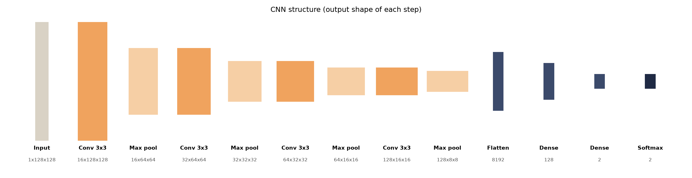
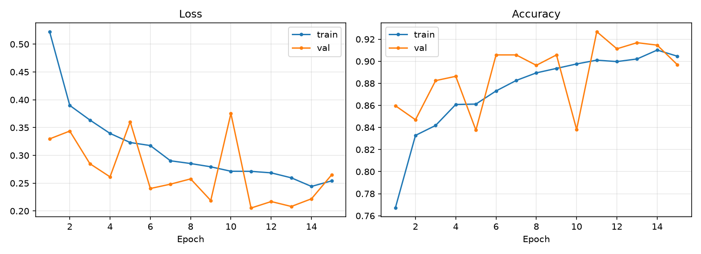
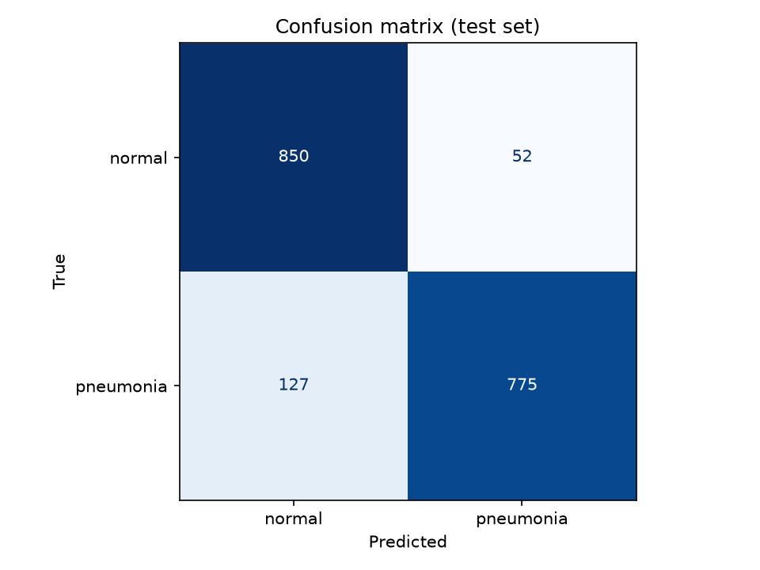
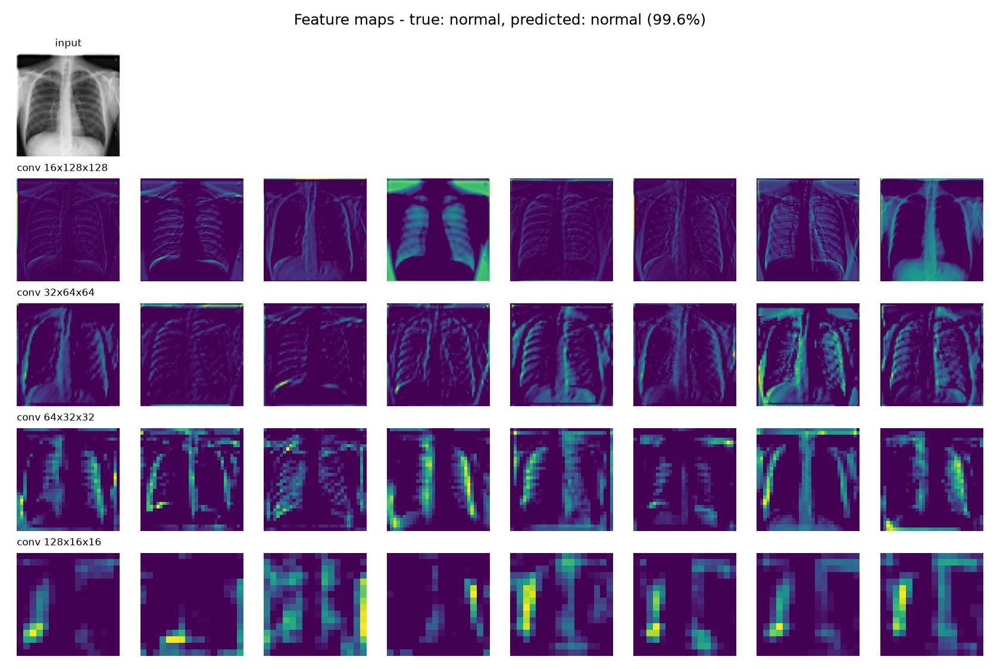
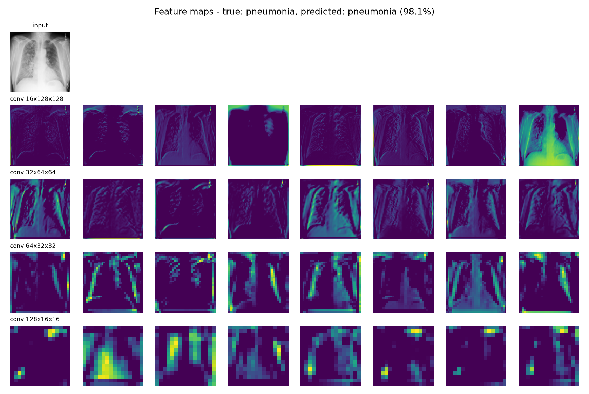

# Pneumonia detection from chest X-rays with a CNN

A small convolutional neural network, trained from scratch on a CPU, that classifies a chest X-ray as **normal** or **pneumonia**.



## Results

Test accuracy on 1,804 held-out images: **90.1%**.

| Class | Precision | Recall | F1 |
|---|---|---|---|
| normal | 0.870 | 0.942 | 0.905 |
| pneumonia | 0.937 | 0.859 | 0.896 |

| Learning curves | Confusion matrix |
|---|---|
|  |  |

### What the network sees

Feature maps from each convolutional layer for a normal and a pneumonia X-ray:




## Repository layout

- `pneumonia_cnn/`: code, notebook, trained model and outputs
- `deck/`: presentation slides (`index.html`) and speaker notes (`speech.md`)

All commands below are run from inside `pneumonia_cnn/`.

## Dataset

The data is 12,024 adult chest X-rays from the [RSNA Pneumonia Detection Challenge](https://www.kaggle.com/c/rsna-pneumonia-detection-challenge), labelled by radiologists. They are taken from the [COVID-19 Radiography Database](https://www.kaggle.com/datasets/tawsifurrahman/covid19-radiography-database) (299×299 PNG) and resized to 128×128.

- **pneumonia:** all 6,012 *Lung Opacity* images.
- **normal:** 6,012 images sampled with a fixed seed from the 8,851 RSNA *Normal* images.
- Only RSNA images are used, so both classes come from the same source. The metadata sheets identify the source of each image.

| Split | Images | Normal | Pneumonia |
|---|---|---|---|
| Train | 8,416 | 4,208 | 4,208 |
| Validation | 1,804 | 902 | 902 |
| Test | 1,804 | 902 | 902 |

The data is not in the repository. `python data.py` downloads the 816 MB archive (no Kaggle login needed) into `data/raw/`. It then builds `data/rsna_pneumonia_128.npz` and exports demo images to `samples/`. The build takes about 20 seconds.

## Model

```
Input 1x128x128
-> [Conv 3x3 -> BatchNorm -> ReLU -> MaxPool] x 4   (16, 32, 64, 128 filters)
-> Flatten 8192 -> Dropout -> Dense 128 -> Dropout -> Dense 2 -> Softmax
```

About 1.15M parameters. Training uses Adam, cross-entropy loss and light augmentation. It runs for 15 epochs, which takes about 10 minutes on a CPU.

## Setup

```bash
python3 -m venv .venv
source .venv/bin/activate
pip install -r requirements.txt
python data.py
```

## Usage

Run everything in one place with **`pneumonia_cnn.ipynb`**, or use the scripts one step at a time:

| Step | Command | Output in `outputs/` |
|---|---|---|
| Train and save | `python train.py` | `model.pt`, `history.json`, `learning_curves.png` |
| Test | `python evaluate.py` | `test_metrics.txt`, `confusion_matrix.png` |
| Understand and explain | `python visualize.py` | `model_summary.txt`, `structure_diagram.png`, `feature_maps_*.png` |
| Predict | `python predict.py samples/*.png` | printed class and probabilities |

`samples/` contains test images exported as PNG files for the demo. `predict.py` accepts any PNG or JPG chest X-ray: it converts it to grayscale, center-crops it and resizes it to 128×128.

## Files

| File | Purpose |
|---|---|
| `data.py` | Download, balanced dataset build, loading, augmentation and preprocessing of new images |
| `model.py` | CNN definition, save and load |
| `train.py` | Training loop and learning curves |
| `evaluate.py` | Accuracy, precision, recall and confusion matrix on the test set |
| `visualize.py` | Layer summary, structure diagram and feature maps |
| `predict.py` | Classify new images |
| `pneumonia_cnn.ipynb` | All steps combined in one notebook |
